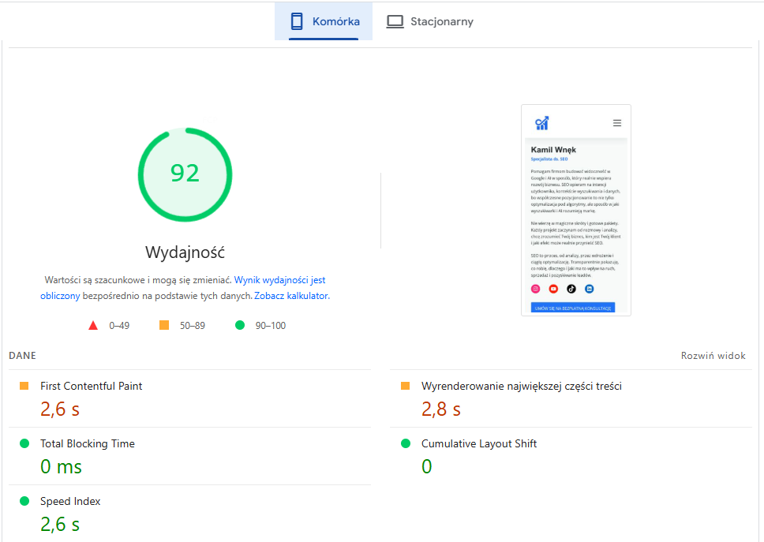
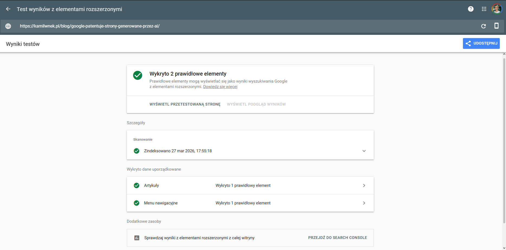

Audyt techniczny SEO to szczegółowe sprawdzenie strony lub sklepu internetowego. Jego celem jest upewnienie się, że roboty wyszukiwarki (np. Google) mogą łatwo znaleźć, odczytać, zrozumieć i zaindeksować stronę. To podstawowy krok, na którym opiera się reszta działań SEO, od pisania treści po <LinkRel href="/oferta/link-building/">link building</LinkRel>.

Dobrze wykonany audyt techniczny pozwala na usunięcie przeszkód, które ograniczają widoczność serwisu. Dodatkowo poprawia wygodę użytkownika – strona może zacząć działać szybciej i być łatwiejsza w obsłudze. Regularne audyty techniczne to stały element skutecznego SEO, ponieważ pozwalają na bieżąco dostosowywać witrynę do aktualnych wymagań Google.

## Czym jest audyt techniczny SEO?

Techniczne SEO skupia się na tym, aby roboty Google mogły poprawnie przejść przez stronę, zrozumieć jej zawartość i dodać ją do indeksu. Obejmuje to działania „na zapleczu” strony – w kodzie, konfiguracji serwera oraz strukturze witryny.

To elementy niewidoczne dla użytkownika, ale kluczowe dla tego, czy strona w ogóle ma szansę pojawić się w wynikach wyszukiwania.

Najważniejsze obszary technicznego SEO m.in.:

- indeksowanie i crawlability,
- struktura adresów URL,
- szybkość ładowania,
- bezpieczeństwo,
- mapa strony XML,
- plik robots.txt,
- dane strukturalne,
- linkowanie wewnętrzne.

### Różnice pomiędzy audytem technicznym, audytem treści oraz audytem UX

Audyt SEO można podzielić na trzy części, które się uzupełniają, ale analizują różne elementy witryny.

- **Audyt techniczny** sprawdza, czy roboty wyszukiwarek mogą wejść na stronę i ją przetworzyć. To fundament, jeśli coś tu nie działa, reszta działań traci sens.
- **Audyt treści** ocenia jakość i dopasowanie contentu do intencji użytkownika.
- **Audyt UX** analizuje wygodę korzystania ze strony – nawigację, czytelność i łatwość wykonywania akcji, np. zakupu.

Każdy z tych obszarów jest ze sobą powiązany, ale problemy techniczne mogą blokować pozostałe działania. Jeśli strona nie jest poprawnie indeksowana, nawet najlepsze treści nie przyniosą efektów.

> <LinkRel href="/oferta/audyt-seo/">Audyt SEO</LinkRel>

## Kiedy warto przeprowadzić techniczny audyt SEO?

Audyt techniczny SEO nie jest jednorazowym działaniem, powinien być elementem stałej opieki nad stroną. Najważniejsze momenty, w których warto go wykonać to:

- uruchomienie nowej strony,
- zmiana CMS-a lub migracja domeny,
- większy redesign,
- nagły lub stopniowy spadek ruchu z Google.

W takich sytuacjach audyt pozwala na szybką identyfikację problemu.

## Jak często zaleca się wykonanie technicznego audytu SEO?

Częstotliwość audytu zależy od wielkości strony i tego, jak często się coś na niej zmienia. Najlepiej traktować to jako regularną kontrolę, a nie jednorazowe zadanie. Dla dużych serwisów rekomenduje się zrobienie audytu co najmniej raz na kwartał. Dzięki temu łatwiej wyłapać błędy.

Dla mniejszych stron, co rok czy pół roku zdecydowanie wystarczy, o ile nie ma żadnych problemów z widocznością. Niezależnie od rozmiaru strony warto robić audyt po większych aktualizacjach. Dobra praktyka to stały monitoring takimi narzędziami jak Ahrefs, SEMrush i Google Search Console.

## Elementy technicznego audytu SEO

### Crawlability i indeksowanie strony

Widoczność witryny w Google zaczyna się od tego, czy roboty wyszukiwarki mogą ją odwiedzać i czy Google ją zaindeksuje. Jeśli Googlebot nie dotrze do podstron, to nie będą one wyświetlane w wynikach wyszukiwania. Crawlowanie to odkrywanie adresów URL, robot odnajduje je przechodząc po linkach wewnątrz serwisu. Następnie analizuje treść i zapisuje informacje w bazie Google. Błędy na tym etapie mogą marnować budżet crawlowania i ograniczać widoczność.

Podczas audytu warto sprawdzić linkowanie wewnętrzne, nagłówki HTTP oraz błędy serwera (404 lub 5xx). Wstępny podgląd indeksu daje operator „site:” (np. site:kamilwnek.pl), dokładniejsze dane na ten temat znajdziesz w Google Search Console w zakładce Indeksowanie -> Strony. Jednym z najczęstszych błędów z indeksowaniem jest ustawienie noindex na ważnych stronach, blokady w pliku robots.txt, błędy serwera czy brak linkowania wewnętrznego. Po naprawie problemu warto poprosić Google o ponowną indeksację adresu URL.

### Plik robots.txt

robots.txt to prosty plik, który mówi robotom do czego mają dostęp na stronie. To jeden z pierwszych plików, które sprawdzane są przez robota wyszukiwarki. Może blokować katalogi, pliki lub inne zasoby. Zła konfiguracja to częsty i bardzo groźny błąd, bo przypadkiem można zablokować ważne sekcje serwisu, a nawet całą stronę.

W audycie należy sprawdzić:

- czy plik nie ma reguł blokujących kluczowe obszary,
- czy jest dostępny pod adresem twojadomena.pl/robots.txt,
- czy nie blokuje CSS i JavaScript.

Reguły robots.txt można sprawdzić w raporcie „robots.txt” w Google Search Console.

### Analiza mapy stron XML

Mapa strony XML to lista adresów URL, które chcesz pokazać wyszukiwarkom. Ułatwia robotom odnalezienie podstron, szczególnie na dużych serwisach i tam, gdzie często dodaje się treści. Bez mapy część podstron może długo pozostać poza zasięgiem robotów wyszukiwarki.

W audycie warto sprawdzić, czy plik z sitemapą jest aktualny i nie posiada błędów (301, 302, 404) oraz to, czy została wysłana do Google Search Console. W mapie powinny znajdować się tylko adresy URL zwracające kod 200. Regularne odświeżenie mapy po dodaniu nowych treści pomaga utrzymać sprawne indeksowanie i widoczność.

### Tagi noindex i canonical

**Tag &lt;meta name=”robots” content=”noindex”>** mówi wyszukiwarce, aby nie dodawała strony do indeksu. To przydatne dla podstron, których nie chcesz w Google, np. regulamin, polityka prywatności, strona z podziękowaniem po wypełnieniu formularza czy strony testowe. Problem jest wtedy, gdy tag noindex pojawia się na ważnych podstronach.

**Tag kanoniczny &lt;link rel=”canonical”>** pomaga przy duplikacji treści. Wskazuje Google, która wersja strony jest główna. Jest to ważne, np. przy sklepach internetowych z filtrowaniem i sortowaniem. Podczas audytu sprawdza się, czy canonical jest dobrze ustawiony. Zły canonical może powodować kanibalizację i spadki pozycji.

### Błędy 3xx, 4xx i 5xx

Kody HTTP to odpowiedzi serwera na próbę wejścia na stronę. Mają duże znaczenie dla SEO i wygody użytkownika. Kody 3xx oznaczają przekierowania, najważniejsze z nich to:

- 301 (stałe przekierowanie),
- 302 (tymczasowe przekierowanie).

Przekierowanie 301 jest właściwe, gdy zmiana jest trwała. Takie przekierowanie przenosi część „mocy” SEO na nowy adres. Nadużywanie 302, łańcuchy przekierowań i przekierowania w linkowaniu wewnętrznym mogą rozpraszać efekty SEO i spowalniać stronę.

Błędy 4xx to błędy po stronie użytkownika, najczęściej spotykanym jest błąd 404. Strony 404 pogarszają UX i marnują budżet crawlowania. Dobra strona 404 powinna posiadać stosowny komunikat i przekierowywać użytkownika do działających sekcji.

Błędy 5xx to błędy po stronie serwera (np. 500) i są poważniejsze, bo mogą prowadzić do wyindeksowania stron.

### Struktura adresów URL i architektura informacji

Czytelne adresy URL i sensowna architektura informacji pomagają i robotom wyszukiwarki oraz użytkownikom. Podczas audytu warto zwrócić uwagę na organizację folderów, format URLi i ryzyko duplikacji treści. Dobrze ułożony URL jest krótki i jasno mówi o tym, co jest na stronie.

Pomaga także płaska struktura, w której ważne podstrony są dostępne w maksymalnie trzech kliknięciach od strony głównej. Folder powinien odpowiadać nawigacji (np. /blog/k/podstawowe-seo), a nie prowadzić do długich i nieczytelnych ścieżek. Taka struktura ułatwia indeksowanie, wspiera linkowanie wewnętrzne i korzystanie ze strony.

_Przykład przyjaznego adresu URL_

### Wydajność strony i Core Web Vitals

Szybkość i sprawność korzystania z witryny wpływa zarówno na użytkowników, jak i na pozycje w Google. Wolne ładowanie strony oznacza wyższy współczynnik odrzuceń i niższe konwersje. Google potwierdza, że wydajność jest jednym z czynników rankingowych.

Google mierzy jakość działania strony m.in. przez Core Web Vitals:

- **LCP (Largest Contentful Paint)** – mówi o tym, jak szybko ładuje się największy element treści.
- **INP (Interaction to Next Paint)** – jak szybko strona reaguje na działanie użytkownika
- **CLS (Cumulative Layout Shift)** – czy układ strony nie „skacze” podczas ładowania kolejnych elementów.

Do sprawdzenia wydajności warto korzystać z takich narzędzi jak Google PageSpeed Insights, GTmetrix czy Lighthouse.

_Wynik PageSpeed Insights dla mobilnej wersji kamilwnek.pl_

### Dostosowanie strony do urządzeń mobilnych i Mobile-First Indexing

Dzisiaj spora część ruchu pochodzi z urządzeń mobilnych, więc każda strona czy sklep musi dobrze na nich działać. Google używa Mobile-First Indexing, czyli ocenia stronę na podstawie wersji mobilnej. Jeśli wersja mobilna jest słaba, spadają pozycje i ruch.

Mobile-First Indexing oznacza też to, że treść na wersji mobilnej i desktopowej powinna być podobna. Jeśli na telefonie brakuje ważnych treści, linków czy danych strukturalnych, może to szkodzić pozycji. Szybka i wygodna wersja mobilna poprawia UX i SEO.

#### Jak sprawdzić wersję mobilną strony?

Do sprawdzenia wersji mobilnej przyda się raport „Obsługa na urządzeniach mobilnych” w Google Search Console oraz tryb responsywny w Chrome DevTools. Regularne sprawdzenie raportów potrafi szybko znaleźć problematyczne podstrony.

Najczęstszymi problemami w wersji mobilnej są:

- elementy klikalne zbyt blisko siebie,
- treść wychodząca poza ekran,
- brak dopasowania do rozdzielczości
- zbyt mała czcionka.

### Bezpieczeństwo strony i HTTPS

Bezpieczeństwo wpływa na zaufanie użytkowników i jest sygnałem dla Google’a. Strony na HTTPS są preferowane, a strony na HTTP mogą być oznaczone jako „niebezpieczne”. To obniża konwersję, ale także psuje wizerunek. W audycie trzeba sprawdzić, czy SSL działa poprawnie i czy nie ma problemów z mieszaną treścią.

#### Certyfikat SSL

SSL szyfruje dane przesyłane między przeglądarką a serwerem. HTTPS to standard dla każdej strony. Daje większe zaufanie w postaci kłódki na panelu adresu oraz może pomagać w rankingu. Dodatkowo część funkcji wymaga bezpiecznego protokołu.

Wdrożenie HTTPS obejmuje pozyskanie certyfikatu (np. Let’s Encrypt), instalację na serwerze i zadbanie o przekierowania 301 z HTTP na HTTPS, zmianę linków i zasobów na wersję bezpieczną.

#### Problemy z mieszaną treścią (mixed content)

Mieszana treść pojawia się w momencie, kiedy strona na HTTPS ładuje część zasobów po HTTP (obrazki, CSS, JS). To osłabia bezpieczeństwo, a przeglądarki mogą blokować takie elementy lub pokazywać ostrzeżenia. Przekłada się to na gorsze działanie strony i może odstraszać użytkowników.

W audycie można znaleźć wszystkie odwołania do HTTP i zmienić je na HTTPS. Często to wymaga przeszukania HTML, CSS i JS. Po poprawkach warto sprawdzać stronę w narzędziach developerskich i monitorować, czy problem nie wraca.

### Dane strukturalne (schema.org)

Dane strukturalne to sposób oznaczenia treści, tak aby wyszukiwarki lepiej rozumiały, co jest na stronie. Dzięki nim Google może rozpoznać, np. artykuł, produkt, opinię czy wydarzenie. Poprawne dane strukturalne Schema.org zwiększają szansę na rich snippets, czyli rozszerzone wyniki (np. gwiazdki ocen, cena, dostępność). To zwykle poprawia CTR i zwiększa ruch organiczny.

Schema.org to standard używany przez największe wyszukiwarki. Dane strukturalne nie zawsze podnoszą pozycję, ale pozwalają zrozumieć robotom wyszukiwarki o czym jest dana podstrona.

#### Najczęstsze typy danych strukturalnych

Przykładowe typy danych strukturalnych, które najczęściej się pojawiają:

- **Article** – dla wpisów blogowych i artykułów, może pokazywać autora i datę.
- **FAQ** – sekcja pytań i odpowiedzi, widoczna w wynikach jako rozwijane elementy (aktualizacja 30.10.2026. Obecnie sekcja FAQ nie jest wyświetlana w wynikach wyszukiwania. Więcej na ten temat w artykule „<LinkRel href="/blog/dane-strukturalne-czym-sa-i-jak-wdrozyc-poradnik-schema-org/">Dane strukturalne – czym są i jak je wdrożyć?</LinkRel>„).
- **Product** – cena, dostępność, oceny i recenzje (najważniejsze dla e-commerce).
- **LocalBusiness** – dane firmy, takie jak godziny, adres i opinie.
- **Review** – opinie i oceny, często jako gwiazdki.

Dobrze wdrożone dane strukturalne sprawiają, że wynik wygląda lepiej i może zbierać więcej kliknięć.

_Dobrze wdrożone dane strukturalne w sklepie x-kom.pl_

#### Jak sprawdzić dane strukturalne?

Żeby Google mogło użyć danych strukturalnych, muszą być zapisane poprawnie. Najważniejsze narzędzie to Rich Results Test od Google. Sprawdza, czy strona może wyświetlać dane strukturalne i pokazuje błędy.

Przydaje się także Schema Markup Validator, który sprawdza poprawność składni oraz Chrome DevTools, gdzie można podejrzeć JSON-LD lub Microdata w kodzie. Regularna kontrola pomaga utrzymać poprawne oznaczenie i wykorzystać je w wynikach wyszukiwania.

_Wynik testu dla podstrony z artykułem „Google patentuje strony generowane przez AI”_

Więcej na temat danych strukturalnych przeczytasz w poniższym artykule:

> <LinkRel href="/blog/dane-strukturalne-czym-sa-i-jak-wdrozyc-poradnik-schema-org/">Dane strukturalne – czym są i jak wdrożyć? Poradnik Schema.org</LinkRel>

### Optymalizacja grafik, kodu CSS i JavaScript

Optymalizacja obrazów i kodu wpływa na szybkość ładowania i sposób, w jaki strona jest wyświetlana i odczytywana przez roboty. W przypadku grafik warto sprawdzić format, kompresję, nazwy plików, atrybuty alt, a także wdrożenie lazy loading. Zbyt ciężkie obrazy to jeden z najczęstszych powodów wolnego ładowania.

**Wiele z tych problemów trudno wychwycić bez analizy danych i narzędzi.**

<Cta label="Jeśli chcesz, mogę to sprawdzić za Ciebie!" href="/kontakt/" />

## Narzędzia do wykorzystania w technicznym audycie SEO

Audyt techniczny SEO trudno zrobić bez narzędzi. Dają dużo danych, ale ważna jest poprawna interpretacja. Same narzędzia nie podejmą decyzji za człowieka, pokażą problem, ale analityk wybiera, co jest przyczyną i jak to naprawić.

### Crawlery SEO – Screaming Frog, Sitebulb

Crawlery SEO to programy, które działają jak roboty wyszukiwarek i skanują stronę. To podstawowe narzędzia do wykorzystania przy audycie technicznym. Najpopularniejszym narzędziem jest Screaming Frog, który w wersji darmowej pozwala na skan 500 adresów URL. Sprawdza linki, przekierowania, kody HTTP, meta tagi, canonicale i nagłówki.

### Narzędzia od Google – Search Console, PageSpeed Insights i Lighthouse

Google udostępnia darmowe narzędzia, które stanowią bazę audytu. Google Search Console pokazuje, jak Google widzi stronę. Są tam informacje na temat indeksowania, błędów HTTP, mapy witryny i podstawowe dane o wynikach. To dobre miejsce na start, jak i do późniejszego monitoringu.

Google PageSpeed Insights i Lighthouse sprawdzają wydajność. PageSpeed pokazuje Core Web Vitals dla urządzeń mobilnych i desktopowych, a także pokazuje sugestie poprawek. Lighthouse (w przeglądarce Chrome) robi audyt wydajności, dostępności, SEO i dobrych praktyk. Te narzędzia pozwalają na kontrolę stanu strony po zmianach.

### SSL Labs, XML Sitemap Checker, Robots.txt Tester

Poza crawlerami i narzędziami od Google’a, do wykonania audytu SEO przydają się także walidatory. SSL Labs sprawdza konfigurację HTTPS i jakość SSL. Może wskazać problemy, które wpływają na bezpieczeństwo i zaufanie.

XML Sitemap Checker ocenia mapę witryny. Robots.txt Tester pozwala sprawdzić, czy reguły nie blokują ważnych zasobów. Do danych strukturalnych używa się Rich Results Test. Takie walidatory dają szybkie odpowiedzi, czy kluczowe elementy działają poprawnie.

### Analiza logów serwera

Analiza logów serwera pokazuje, jak roboty naprawdę poruszają się po stronie. Crawlery „udają” robota, a logi pokazują faktyczne wejścia: jakie adresy były odwiedzane, jak często i z jakim kodem HTTP. To wartościowe dane, szczególnie dla dużych serwisów.

Logi mogą ujawnić przykładowo próby wejścia na nieistniejące strony, zapętlone przekierowania, pomijanie ważnych sekcji albo marnowanie budżetu crawlowania na mało istotne podstrony. Do analizy można użyć, np. Screaming Frog Log File Analyser.

