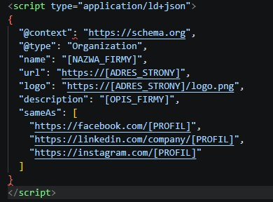

Dane strukturalne (Schema.org) to dodatkowe informacje umieszczane w kodzie strony internetowej, które pomagają wyszukiwarkom i AI lepiej zrozumieć zawartość witryny. To dzięki nim w Google wyświetlane są rozszerzone wyniki wyszukiwania (np. cena produktu, dostępność).

**TL;DR**

- Dane strukturalne (Schema.org) pomagają wyszukiwarkom i AI zrozumieć, czym jest Twoja strona, firma, autor lub usługa.
- Najpopularniejszym formatem wdrożenia jest JSON-LD.
- Dane strukturalne mogą zwiększyć szansę na wyświetlenie rozszerzonych wyników wyszukiwania.
- Dane strukturalne nie są bezpośrednim czynnikiem rankingowym, ale wspierają interpretację treści.
- Najważniejsze typy danych strukturalnych dla większości stron to: Organization, Person, Article, BreadcrumbList, FAQPage, Product.
- Poprawność wdrożenia warto sprawdzać za pomocą Rich Results Test oraz Schema Markup Validator.

## Czym są dane strukturalne?

Dane strukturalne to ustandaryzowany sposób opisywania informacji, które znajdują się na stronie. Można je porównać do etykiet przyklejonych do poszczególnych elementów na stronie.

Dla użytkownika tekst:

„Kamil Wnęk świadczy usługi SEO w Warszawie”

jest zrozumiały sam w sobie. Dla robotów wyszukiwarki i modeli AI nie zawsze jest to jasne:

- czy Kamil Wnęk jest osobą?
- czy SEO jest usługą?
- czy Warszawa to lokalizacja działalności?

Schema pozwala jednoznacznie określić relacje pomiędzy tymi elementami. W praktyce można wskazywać, że:

- Kamil Wnęk jest osobą (Person),
- prowadzi firmę W3 Digital (Organization),
- oferuje usługę SEO (Service),
- działa na określonym obszarze, w przykładzie Warszawa (AreaServed)

Dzięki temu algorytmy nie zgadują poszczególnych informacji, a dostają je na tacy.

## Czym jest Schema.org?

Schema.org to wspólny standard stworzony przez największe wyszukiwarki internetowe (Google, Bing, Yahoo i Yandex). Projekt powstał po to, aby właściciele stron mogli przekazywać informacje robotom wyszukiwarek w jednolitym formacie.

Schema.org działa na zasadzie słownika zawierającego:

- typy obiektów (np. Person, Organization),
- właściwości obiektów (np. name, description, image),
- relacje pomiędzy encjami.

Przykładowo firma może zostać opisana jako Organization, a jej właściciel jako Person powiązany z organizacją.

## Dlaczego dane strukturalne są ważne?

Odpowiedź jest krótka: pomagają wyszukiwarkom i systemom AI lepiej rozumieć Twoją stronę.

Dodanie danych strukturalnych nie oznacza wyższych pozycji w Google, ponieważ Schema.org nie jest bezpośrednim czynnikiem rankingowym. Dane strukturalne mogą jednak zwiększyć prawdopodobieństwo uzyskania rozszerzonych wyników wyszukiwania i poprawić interpretację treści.

Najważniejsze korzyści to:

- lepsze rozumienie strony przez roboty wyszukiwarek,
- możliwość wyświetlenia rozszerzonych wyników wyszukiwania (Rich Results),
- łatwiejszą identyfikację marki i autora,
- budowę spójnego grafu wiedzy.

## Dane strukturalne a AI

W maju 2026 roku Ahrefs opublikował wyniki badań, w których prześledził 1885 stron, które dodały schemę. Wniosek z badania jest następujący: **dodanie schemy nie zwiększyło cytowań w AI.**

Według Eweliny Podrez-Siama z artykułu: „Schema.org. Dane strukturalne, które rozumie Google (i co z nich zostaje w erze AI)”:

> „Schema nadal jest słownikiem, którym porządkujesz encje dla systemów RAG i klasycznej wyszukiwarki – obniża koszt przetworzenia treści, ujednoznacznia, kto jest autorem i czego dotyczy strona. Ale nie jest skrótem do widoczności w AI. To, co naprawdę decyduje o cytowaniu, dzieje się w widocznej treści: jasna struktura, odpowiedź na wejściu, fakty, które da się wyciągnąć i zacytować bez utraty sensu. Schema porządkuje to, co pod spodem – ale LLM-y cytują Cię za to, co widać na wierzchu.”

## Formaty danych strukturalnych

Dane strukturalne można wdrożyć na trzy sposoby:

- JSON-LD w sekcji &lt;head>.
- Microdata poprzez dodanie atrybutów bezpośrednio do elementów HTML.
- RDF, który stanowi bardziej zaawansowaną metodę osadzania metadanych w kodzie strony.

**Preferowanym przez Google formatem Schemy jest JSON-LD**.

### Przykładowy kod JSON-LD

Poniżej screen danych strukturalnych dla Organizacji.

## Jak wdrożyć dane strukturalne?

Są co najmniej trzy drogi do wdrożenia danych strukturalnych:

- ręczne pisanie kodu korzystając z dokumentacji schema.org,
- użycie generatora schema (np. [https://technicalseo.com/tools/schema-markup-generator/](https://technicalseo.com/tools/schema-markup-generator/)),
- w przypadku korzystania z WordPressa użycie wtyczki takiej jak RankMath czy All in One SEO. Inne popularne CMSy posiadają również dedykowane rozwiązania do automatycznego generowania danych strukturalnych.

**TIP: Niektóre szablony WordPress – w szczególności Buildery mają funkcję generowania automatycznych danych strukturalnych. Sprawdź w ustawieniach szablonu, jak je wyłączyć jeśli korzystasz z wtyczki lub sam dodajesz kod.**

## Jak sprawdzić poprawność danych strukturalnych?

Poprawność danych strukturalnych można przetestować po wdrożeniu na produkcję lub przed wdrożeniem. Do testów używa się dwóch narzędzi:

- [Schema Markup Validator](https://validator.schema.org/) od schema.org. Sprawdza całą składnię schema.org, nie skupia się na typach wspieranych przez Google.
- [Rich Results Test](https://search.google.com/test/rich-results) od Google. Sprawdza, czy kod kwalifikuje się do rozszerzonych wyników wyszukiwania.

Kolejnym narzędziem do monitoringu poprawności i ewentualnych uwag w Schemie jest Google Search Console. W zależności od typu danych strukturalnych w panelu GSC mogą pojawić się następujące zakładki:

## Najważniejsze typy Schema.org

Nie każda strona potrzebuje wszystkich typów danych strukturalnych. Jeśli prowadzisz bloga, to nie będziesz używać typu Product lub Service. Warto jednak je znać i wiedzieć do czego służą.

| TYP | DO CZEGO SŁUŻY? |
| --- | --- |
| Organization | Opisuje firmę, markę lub organizację. |
| Person | Opisuje autora lub właściciela strony. |
| Article | Stosowany dla artykułów i wpisów blogowych. |
| BreadcrumbList | Pomaga wyszukiwarkom zrozumieć strukturę nawigacji. |
| LocalBusiness | Przydatny dla firm działających lokalnie. |
| Product | Przeznaczony dla sklepów internetowych i kart produktów. |
| FAQPage | Służy do oznaczania sekcji pytań i odpowiedzi. Chociaż Google 8 maja 2026 poinformowało, że wycofuje funkcję wyników rozszerzonych z FAQ, to nadal warto ten typ stosować. |

## Wdrożenie danych strukturalnych krok po kroku

### Krok 1 – Określ rodzaj strony

Pierwszym krokiem jest ustalenie, jaki typ strony chcesz opisać za pomocą danych strukturalnych. Schema.org oferuje setki typów znaczników, dlatego warto zacząć od określenia celu danej podstrony.

Na przykład:

- strona firmowa -> Organization,
- artykuł blogowy -> Article lub BlogPosting,
- karta produktu -> Product,
- strona usługi -> Service,
- profil autora -> Person.

Najważniejsze przy wdrożeniu danych strukturalnych jest dopasowanie ich do rzeczywistej zawartości strony.

### Krok 2 – Wybierz typ Schema.org

Gdy określisz charakter podstrony, wybierz odpowiedni typ.

| Typ strony | Zalecana schema |
| --- | --- |
| Strona główna firmy | Organization, WebSite |
| Strona lokalnej firmy | LocalBusiness |
| Artykuł blogowy | Article / BlogPosting + Person |
| Usługa | Service |
| Sklep internetowy | Product, Offer |
| FAQ | FAQPage |

Pamiętaj, że na stronie możesz wdrożyć kilka typów danych strukturalnych. Artykuł może zawierać zarówno Article, Person, jak i BreadcrumbsList.

### Krok 3 – Przygotuj kod JSON-LD

Najpopularniejszym sposobem wdrażania danych strukturalnych jest wykorzystanie formatu JSON-LD. Są tutaj dwa rozwiązania.

#### Opcja 1 – Ręczne tworzenie kodu

Polega na samodzielnym przygotowaniu kodu. Można to zrobić ręcznie przeglądając dokumentację schema.org. To rozwiązanie jest najbardziej czasochłonne, ale daje największą kontrolę nad wdrożeniem. A przy okazji poznasz dokładniej, jakie typy danych strukturalnych oferuje schema.org.

#### Opcja 2 – Generatory schema lub AI

Jeśli nie chcesz pisać kodu ręcznie, możesz wykorzystać dostępne generatory danych strukturalnych lub poprosić AI o wygenerowanie takiego kodu podając niezbędne informacje.

### Krok 4 – Dodaj kod do strony

Po przygotowaniu kodu należy umieścić go na stronie. W zależności od używanego CMS-a różni się sposób wdrożenia.

#### WordPress

W przypadku korzystania z WordPressa najprostszym rozwiązaniem jest wykorzystanie wtyczki SEO (RankMath lub Yoast SEO). Tutaj podstawowe dane strukturalne generowane są automatycznie. W przypadku RankMath największą kontrolę nad rodzajem schemy jest kupienie wersji płatnej.

Jeśli na WordPressie chcesz dodać własny kod możesz wykorzystać wtyczkę „Header Footer Code Manager”.

#### Shopify

Wiele motywów Shopify oferuje podstawowe dane strukturalne. Dodatkowe schema można wdrożyć poprzez edycję plików Liquid lub dedykowane rozwiązania dla tego CMSa.

### Krok 5 – Zweryfikuj poprawność wdrożenia

Po dodaniu danych strukturalnych warto się upewnić, że wyszukiwarki odczytują je poprawnie. Najlepiej do tego wykorzystać Rich Results Test lub Schema Markup Validator.

### Krok 6 – Monitoruj i aktualizuj dane

Wdrożenie schema nie jest działaniem jednorazowym. Jeśli zmieniasz dane firmy, adres, ofertę usług, autora treści, ceny produktów itp. należy zaktualizować dane strukturalne. Nieaktualne informacje mogą powodować błędy w interpretacji strony, a także wyświetlać błędne rozszerzone wyniki wyszukiwania.

## Najczęściej popełniane błędy przy wdrożeniu Schema

Najczęściej pojawiające się problemy dotyczące wdrożenia Schema to:

- niezgodność danych z treścią strony,
- brak wymaganej właściwości,
- duplikowanie znaczników,
- oznaczanie elementów niewidocznych dla użytkownika,
- stosowanie nieaktualnych typów danych.

**Dane strukturalne muszą odzwierciedlać rzeczywistą zawartość strony**.

## Najczęściej zadawane pytania i odpowiedzi

Czy Schema wpływają na pozycję w Google?

Nie. Poprawiają interpretację strony i mogą zwiększyć CTR dzięki rozszerzonym wynikom wyszukiwania, ale nie są czynnikiem rankingowym wpływającym na pozycje.

Czy każda strona powinna mieć Schema?

Tak. Każda strona może korzystać z takich typów danych jak Organization, Person lub Article.

Czy WordPress dodaje automatycznie dane strukturalne?

Nie. Natomiast wiele motywów i wtyczek wdraża podstawowe dane strukturalne, jednak często wymagają one rozbudowy i uzupełnienia. Najczęściej jest to dostępne w płatnych wersjach.

Co to są dane strukturalne?

Dane strukturalne to znaczniki dodawane do kodu strony internetowej, które pomagają wyszukiwarkom i systemom AI zrozumieć jej zawartość. Dzięki nim można jednoznacznie określić, czy dana treść opisuje firmę, osobę, produkt, usługę, wydarzenie lub artykuł.

Czym jest Schema.org?

Schema.org to standard danych strukturalnych rozwijany przez największe wyszukiwarki internetowe. Zawiera zestaw typów i właściwości umożliwiających opisywanie różnych elementów strony w sposób zrozumiały dla robotów.

## Źródła

- „We Tracked 1,885 Pages Adding Schema. AI Citations Barely Moved” Louise Linehan, Xibeijia Guan [https://ahrefs.com/blog/schema-ai-citations/](https://ahrefs.com/blog/schema-ai-citations/)
- „Schema.org. Dane strukturalne, które rozumie Google (i co z nich zostaje w erze AI)” Ewelina Podrez-Siama [https://podrez.pl/dane-strukturalne-schema-w-pigulce/](https://podrez.pl/dane-strukturalne-schema-w-pigulce/)
- [https://schema.org](https://schema.org)
- [https://developers.google.com/search/updates?hl=pl#removing-faq-rich-result](https://developers.google.com/search/updates?hl=pl#removing-faq-rich-result)
